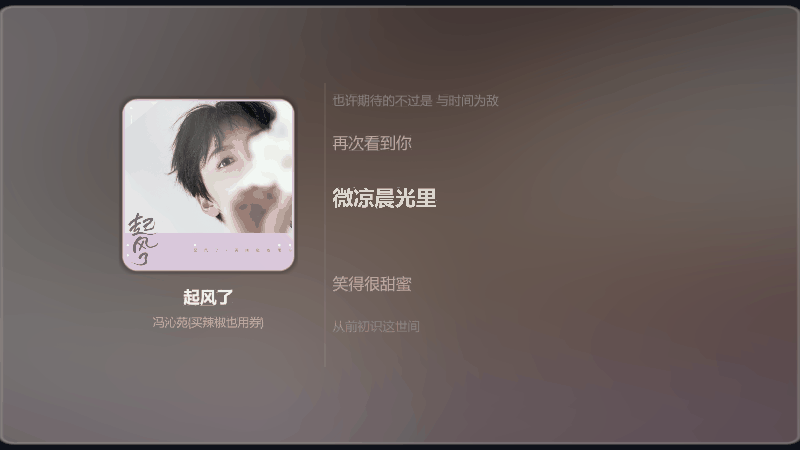
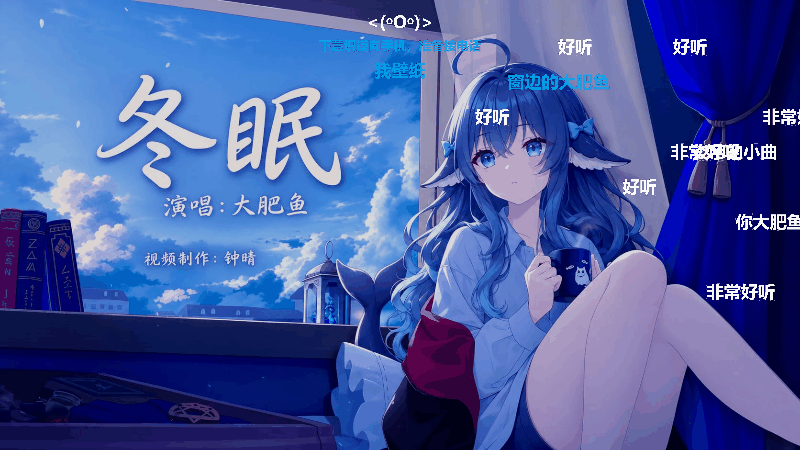

# SleepMusic Player · 眠境音乐歌词播放器 (VPM)

**支持任意 VRChat 视频播放器（零第三方依赖）** 的开箱即用 GPU 音乐歌词舞台 VPM 扩展包——**无需使用底部控件栏**，可将纯歌词与封面舞台直接拖到任意播放器屏幕上自动适配大小与朝向！



### GPU 弹幕叠加层实机动态预览（真实 B 站视频 [`BV1iiWi6oE9b`](https://www.bilibili.com/video/BV1iiWi6oE9b) 弹幕）


## 核心特性
- **纯歌词与封面舞台（无底部控件栏，适配任意播放器）**：内置独立 `SleepMusicStage (Lyrics & Cover Only).prefab`，仅负责 **GPU BC1 封面解码、流体光晕氛围背景与逐字暖金歌词展示**，不接管也不遮挡原播放器的控制栏。
- **拖拽自动绑定 + 屏幕自适应 + 反面防护与诊断**：直接拖到任意播放器（**VizVid / ProTV / YamaPlayer / IWsync / USharpVideo / 原生 `VRCVideoPlayer`**）下即可自动绑定底层播放器、自动对齐目标屏幕大小与正面法线（自动抵消父级负缩放防止镜像/反面），并提供 **「翻转 180°」** 与 **一键诊断检查**（排查未绑定、负缩放反面、音频静音、材质缺失等常见问题）。
- **2 行毛玻璃智能胶囊 UI**：音量点击展开抽屉、齿轮设置防抖自动收起、播放时自动隐藏输入框文字避免与时间戳重叠。
- **GPU 高性能视频弹幕引擎（`1.1.6-beta.2` 升级，最高 10,000 条不掉帧）**：兼容 `/v3/vrc-danmaku` 与 `/v4/vrc` 弹幕接口，支持最高 **10,000 条弹幕分帧无卡顿解析** + **80 槽位 GPU 顶点驱动滚动 + GPU 4 点片段描边 + GPU 硬件裁剪**（单 DrawCall 批处理、零 `Outline` 顶点膨胀、飞行期间零 Canvas 重建），12 轨道防重叠滚动 + 顶/底部固定弹幕、24 位 RGB 颜色还原、暂停定格与拖动二分定位。
- **GPU BC1 封面解码 & 无重影流体光晕背景**：单 Pass GPU 解码 `wimbc1png1` 数据图集，开启硬件自动 MipMap + 36 点黄金角圆盘流体模糊，彻底消除带文字封面的叠字重影，同时左侧封面卡片保持 Mip 0 100% 锐利。
- **GPU 逐字暖金扫光歌词**：兼容网易云 YRC / 酷狗 KRC / QQ 原生 QRC 逐字时间轴，无逐字时自动启用音节感知拟真唱速，支持双语翻译、5 行 Apple Music 风格平滑上滑与纯音乐居中黑胶模式，播放 B 站/YouTube 等视频时自动隐身绝不遮挡画面。
- **VRC 中文性能与错误码日志**：实时输出网络拉取耗时、GPU 封面解码耗时、切行渲染耗时、逐字上色耗时以及 `402 / 404 / 502` 等 HTTP 状态码中文说明。
- **一键替换域名与音乐池设置工具**：支持在 Inspector 或菜单 `Tools -> 眠境音乐播放器 -> 接口与音乐池一键配置` 一键更换域名、世界 ID、路径模板与池槽位数量（`1 ~ 500`）。

## 快速使用（VCC / ALCOM）
1. 在 VCC 或 ALCOM 中添加本仓库的 VPM Listing 地址：
   - 本仓库 VPM 地址：`https://xiaoxnmv.github.io/SleepMusicPlayer-VPM/index.json`
   - 依赖：仅 `com.vrchat.worlds >= 3.7.0`（无需安装任何特定视频播放器！）
2. 在项目里安装 **SleepMusic Player (眠境音乐歌词播放器)**。
3. 在 Unity 场景中右键 **`GameObject -> 眠境音乐播放器 -> 创建开箱即用播放器`**（或直接拖入 `Packages/com.miaobai.sleep-music-player/Prefabs/SleepMusicPlayer (All-in-One).prefab`）。
4. 选中 `SleepMusicLyricsController`，点击 **「一键自动绑定场景内任意播放器」**（若使用自定义播放器，也可手动填入 `customUrlVarName` 或直接调用 `SetExternalUrl(VRCUrl)`）。
5. 打开菜单 **`Tools -> 眠境音乐播放器 -> 接口与音乐池一键配置`**，填入你的接口域名、世界 ID 与槽位数量，点击 **「一键替换并同步到场景」** 即可上传测试。

## 自动发版与 VPM 镜像同步（GitHub Actions）
- 修改 `Packages/com.miaobai.sleep-music-player/package.json` 中的 `version`（例如改为 `1.4.0`），提交后推送对应 Tag：
  ```bash
  git tag v1.4.0
  git push origin main --tags
  ```
- GitHub Actions（`.github/workflows/release-vpm.yml`）会自动：
  1. 打包带完整 `.meta` 文件的 `com.miaobai.sleep-music-player-<version>.zip`；
  2. 计算 `zipSHA256` 并发布 GitHub Release；
  3. 自动更新 `docs/index.json`（VPM Listing）与 `docs/index.html`（一键添加 VCC 页面）并同步到 GitHub Pages。
